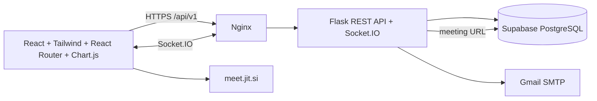

# NEXUS CRM

NEXUS CRM is a React customer and operations portal backed by a Flask REST/WebSocket API and SQLAlchemy, using your Supabase PostgreSQL database. Customers can browse products, create an account and sign in immediately, raise and track tickets, exchange messages, attach files, and join Jitsi meetings scheduled for tickets or approved sales leads. Staff work routed queues; the main administrator manages the team and reviews analytics, activity, and exports.

> The active CRM uses the Flask app in `flask-backend/` with Supabase PostgreSQL.

## What is implemented

- JWT access and rotating refresh tokens, password hashing, logout/revocation, password-reset links, and role-based authorization.
- The browser requires sign-in on each fresh app load and clears previously stored local session tokens.
- Roles: Customer, Sales Manager, Product Maintenance, Support, and Main Admin. The first Main Admin is provisioned explicitly from environment variables; public registration can only create customers.
- Product catalogue with admin create/edit/activate/deactivate.
- Sales lead pipeline for Main Admin and Sales Managers. Assigned enquiries are visible to Sales Managers while awaiting verification; Sales submits verification to the Main Admin, who receives an in-app/email notification and must approve before sales follow-up. Product-interest-only leads continue through support verification and Main Admin approval. The pipeline supports qualification/loss tracking and conversion into a verified customer account plus a Sales-routed enquiry ticket.
- Customer-submitted sales enquiries and signed-in customers' product-interest leads appear in every active Sales Manager's shared pipeline. Use the **Customer enquiries** filter to see one row per enquiry (including repeat enquiries from an existing customer) regardless of its lead's operational status; open a row to review the enquiry alongside the associated lead and approval state. Clicking a sales-enquiry notification takes you to its matching enquiry. The **New** filter continues to show only leads whose status is `NEW`. This does not depend on the source label's spelling or capitalization; manually assigned internal leads remain restricted to their assigned Sales Manager. A Sales Manager verifies the enquiry and submits it for Main Admin approval; approval notifications open the specific lead in the Sales Pipeline, where the team can continue follow-up and verify purchase intent.
- Searchable, filterable, sortable, paginated tickets with customer-only visibility, staff queues, comments, secure file upload/download, status/priority changes, and audit/activity history. Product Maintenance staff can resolve product-defect tickets directly. Main Admin can view ticket overviews and read-only details; conversations, attachments, and ticket updates remain restricted. Ticket exports include only ticket numbers and status.
- Automatic issue routing: Product Enquiry → Sales; Product Defect → Product Maintenance, with an email alert to all active Product Maintenance department members; Technical Support → Support; Critical priority → Main Admin.
- Customer-submitted tickets start at Medium priority; only staff in the ticket's assigned department can change status or priority. Product Maintenance can resolve product-defect tickets directly; ticket priority changes do not reroute them to Main Admin.
- Critical ticket alerts, department assignment, in-app notifications, live Socket.IO notifications, and email notifications sent using the CRM's centrally configured SMTP account.
- Staff ticket updates, lead follow-up emails, and customer notifications all use the same system email account configured by the administrator; individual users do not configure SMTP credentials.
- Ticket email notifications include a readable text and styled HTML version with structured ticket details; critical tickets are prominently flagged in the subject and message.
- Sales enquiry confirmations and assigned-sales alerts include branded HTML and readable plain-text versions. Assigned-sales alerts use a responsive, navy-and-gold layout, structured customer details, an enquiry highlight, and a direct lead-workspace button.
- Per-IP authentication limits and per-endpoint API request limits; configure a shared rate-limit store when running multiple API instances.
- Future-dated meetings can be scheduled from an approved sales lead or a ticket. Lead meetings generate a unique Jitsi room and send the customer a meeting email; scheduled lead meeting links are available from the lead detail panel and the Meetings page.
- Meeting scheduling is idempotent per lead or ticket and start time: repeat submissions return the existing meeting without repeating alerts, notifications, or live events.
- Admin counts and monthly/department/priority analytics, user and department management, and CSV/XLSX/PDF ticket reports.
- Responsive role-aware home pages: customers get ticket, browse, and meeting summaries with product discovery and ticket interactions; staff get department queues; the Main Admin gets team controls and analytics. Dark mode persists across visits.
- Responsive collapsible staff navigation with a keyboard-accessible command palette (Ctrl/Cmd+K) for authorized ticket and lead search, supported shortcuts, and direct ticket detail opening.
- Dashboard summary cards link to their relevant workspaces; lead status filters and dashboard labels reflect the existing API data rather than estimated sales metrics.
- Ticket detail interactions support message exchange, authorized attachment access, and ticket-linked Jitsi meetings. Meeting events refresh the interface once per meeting even if a live event is delivered repeatedly.
- Authenticated AI Support Assistant using a local Ollama model and retrieval from active products plus curated public support documents. Unanswered questions can be routed through the existing support-ticket workflow.
- Customer feedback portal with customer-owned submissions, opt-in public display names, pending-review moderation, and an approved-only public review page.
- SQLAlchemy models, Alembic migrations, Supabase/PostgreSQL connectivity, API documentation, tests, and CI.

## Project map

| Path | What it contains |
| --- | --- |
| `frontend/` | React, TypeScript, and Vite browser application |
| `flask-backend/app/` | Flask API, authentication, business logic, database models, and Socket.IO handlers |
| `flask-backend/migrations/` | Alembic schema history; use these migrations to update the database |
| `flask-backend/tests/` | Backend API and business-logic tests |
| `flask-backend/knowledge_base/` | Public support documents used by the local AI Support Assistant |
| `flask-backend/openapi.yaml` | API contract |
| `docs/system-design.md` | Architecture, entity relationships, authorization boundaries, and operational notes |
| `infra/nginx/` | Reverse-proxy configuration used by the active Docker Compose setup |
| `docker-compose.smart-crm.yml` | Active container setup for the Flask CRM, frontend, and Nginx; database is Supabase |
| `start-crm.cmd` / `start-crm.ps1` | Start local API and frontend on Windows |
| `connect-supabase.cmd` / `connect-supabase.ps1` | Securely configure the Supabase session-pooler password, migrate, seed, and start |

`docker-compose.yml` is a separate, older Django/PostgreSQL/Redis/Celery example and does not describe the active Flask CRM. Use `docker-compose.smart-crm.yml` for this CRM.

## Roles and access

| Role | Main capabilities |
| --- | --- |
| Customer | Browse active products, manage their own support tickets and comments, attach files, schedule ticket meetings, use AI Support, submit feedback, and view their own feedback status |
| Sales Manager | Work assigned sales leads, review enquiry history, update lead progress, submit verification for admin approval, and record purchase verification before conversion |
| Support | Work support queues and support product-interest leads, record contact and verification details, and submit verified product-interest leads for review |
| Product Maintenance | Work tickets routed to the product-maintenance department; no lead-verification or lead-review access |
| Main Admin | Manage users and departments, products, leads, approvals and reviews, dashboard analytics, activity/audit history, and read-only ticket overviews/details |

Staff ticket access is limited to the assigned department or tickets explicitly assigned to that staff member. Main Admin can view ticket overviews and read-only details; conversations, attachments, and ticket updates remain restricted. Public signup creates Customer accounts only. The first Main Admin is provisioned from the backend environment, never from the browser.

## Frontend page checklist

The public pages are available without signing in. All workspace pages require authentication; APIs apply additional role and record-level authorization.

| Page | URL | Intended use |
| --- | --- | --- |
| Sign in | `/login` | Authenticate and enter the workspace |
| Sign up | `/signup` | Register a Customer account |
| Password recovery | `/forgot-password`, `/reset-password` | Request or complete a password reset |
| Email verification | `/verify-email` | Complete account verification when a valid token is supplied |
| Public reviews | `/reviews` | Browse approved customer feedback |
| Dashboard | `/` | Role-aware overview and workspace shortcuts |
| Tickets | `/tickets` | Browse permitted tickets, comments, attachments, and ticket detail |
| Products | `/products` | Browse products; Main Admin can manage the catalog |
| Meetings | `/meetings` | View or schedule ticket-linked meetings |
| Leads | `/leads` | Work authorized sales leads |
| Lead review | `/lead-review` | Support verifies eligible product-interest leads; Main Admin reviews and approves them |
| Admin | `/admin` | Main Admin user, department, dashboard, activity, and reporting tools |
| Feedback | `/feedback` | Customer submissions and their moderation status |
| Feedback moderation | `/admin/feedback` | Main Admin review moderation queue |
| AI Support | `/ai-support`, `/ask-ai` | Ask the authenticated local AI assistant for support |
| Settings | `/settings` | View your account profile |

## End-to-end verification checklist

Use this as a manual acceptance checklist after setup. Items that use external services (email, Ollama, Jitsi, Supabase, or Docker) require those services to be configured and reachable.

### Start-up and account access

- [ ] Create the backend environment file, install the Python and frontend dependencies, and configure Supabase as described below.
- [ ] Start the CRM with `.\start-crm.cmd`; confirm the API health response is `{"status":"ok"}` at `http://127.0.0.1:8001/api/v1/health`.
- [ ] Sign in as the configured Main Admin at `http://127.0.0.1:5173/login`.
- [ ] Register a customer, sign out, sign back in, and verify a fresh browser load requires sign-in.
- [ ] Exercise the forgot-password and reset-password flows. Email delivery requires SMTP; debug-mode links are written to backend logs.
- [ ] Confirm an inactive account and revoked/expired token cannot continue using protected API features.

### Customer workspace

- [ ] Browse and search active products; verify inactive products are not offered as active catalog items.
- [ ] Create a ticket for each issue category and verify the default department routing.
- [ ] Verify new customer tickets start at Medium priority and customers cannot change priority or see another customer's tickets.
- [ ] Open a ticket, exchange customer-visible comments, attach an allowed file type, and download it only from an authorized ticket.
- [ ] Schedule a future ticket meeting, open its Jitsi link, and retry the same ticket/start-time request to verify it does not duplicate the meeting or its alerts.
- [ ] Submit a sales enquiry and check its lead assignment and enquiry-history entry.
- [ ] Submit a support request while signed in and verify it creates a ticket rather than a sales lead.
- [ ] Submit customer feedback, confirm its initial pending state, then view its status in the customer's own feedback list.
- [ ] Open the public reviews page and confirm only approved reviews appear and private email/customer identifiers are not exposed.

### Staff and lead workflows

- [ ] Create one account for each staff role from Admin and analytics; confirm role and department assignment.
- [ ] Sign in as Sales Manager and verify only assigned/authorized leads are available; update a lead and submit its verification for Main Admin review.
- [ ] Sign in as Support and review support/product-interest leads, record contact or verification details, and submit eligible leads for approval.
- [ ] Sign in as Product Maintenance and confirm lead-verification navigation and lead-review API access are unavailable.
- [ ] As Main Admin, approve or reject submitted lead reviews and confirm the decision/history is visible to authorized staff.
- [ ] Record purchase verification and convert an eligible lead; verify the customer account, enquiry history, and routed ticket are linked.
- [ ] Verify a Critical ticket is routed to Main Admin and triggers status-only in-app and live notifications.
- [ ] Confirm staff cannot access another department's ticket queue unless explicitly assigned.

### Main Admin and integrations

- [ ] Create, update, deactivate, and reactivate products; confirm the public catalog reflects active status.
- [ ] Manage users and departments, and review dashboard summaries, charts, activity records, and audit records.
- [ ] Export ticket reports as CSV, XLSX, and PDF.
- [ ] Moderate customer reviews; confirm rejecting or approving a review changes its public visibility as expected.
- [ ] Configure system Gmail SMTP in the backend environment, then verify configured notification emails arrive. SMTP is optional for local use.
- [ ] Configure Ollama and its chat/embedding models; check AI Support health, source-grounded answers, abstention/human handoff, and ticket escalation.
- [ ] Verify Socket.IO notifications update the signed-in user's workspace, and test reconnect behavior after refreshing the browser.
- [ ] If using Docker, confirm the frontend, API, and Nginx start; persistent uploads remain after container recreation; the API still reaches Supabase.

## Architecture



The entity relationships and trust boundaries are described in [docs/system-design.md](./docs/system-design.md). The endpoint contract is in [flask-backend/openapi.yaml](./flask-backend/openapi.yaml). Database changes are managed by the versioned Alembic scripts in `flask-backend/migrations/versions/`.

## Run locally on Windows (no Docker required)

The active CRM connects to your Supabase PostgreSQL session pooler. You do not need to install or start a local database server.

### One-command startup

After completing the first-time setup below and connecting Supabase, start both servers from the repository root:

```powershell
.\start-crm.cmd
```

The script checks configuration and port availability, applies database migrations, idempotently seeds the admin and sample products, checks API health, then opens the Flask API and React development server in separate terminal windows. Use **Ctrl+C** in each server window to stop it. To use another API host during frontend development, set `VITE_API_PROXY_TARGET` before running the script; Socket.IO follows the same target unless `VITE_SOCKET_PROXY_TARGET` is set.

### 1. Prepare the Flask API

Open a PowerShell terminal at the repository root and run:

```powershell
cd ".\flask-backend"
py -3 -m venv .venv
.\.venv\Scripts\python.exe -m pip install -r requirements.txt
Copy-Item .env.example .env
notepad .env
```

Install the frontend dependencies once:

```powershell
cd "..\frontend"
npm.cmd install
cd ".."
```

In `flask-backend\.env`, set two different random signing secrets of at least 32 characters and your own admin email and password (12+ characters). Keep the Supabase URL template as-is; the connection helper securely prompts for the database password.

```dotenv
FLASK_DEBUG=0
SECRET_KEY=put-a-unique-random-secret-here-at-least-32-characters
JWT_SECRET_KEY=put-a-different-random-secret-here-at-least-32-characters
FRONTEND_URL=http://127.0.0.1:5173
CORS_ORIGINS=http://127.0.0.1:5173,http://localhost:5173,http://localhost:8080
CRM_ADMIN_EMAIL=
CRM_ADMIN_PASSWORD=
CRM_ADMIN_NAME=Your Name
```

Keep `.env` private. For development, leave the Gmail settings empty; email delivery will be reported as unavailable.

Connect the Supabase database and start the CRM:

```powershell
.\connect-supabase.cmd
```

The helper applies migrations, creates the configured Main Admin and sample products, starts the API and frontend, and verifies the admin login. It asks for the database password in a hidden prompt; it does not print or ask you to share the password in chat. Open `http://127.0.0.1:5173/login`. To stop the servers, press **Ctrl+C** in their server windows.

The first run creates the Main Admin and three sample products. Use **Admin and analytics** to create Sales Manager, Product Maintenance, and Support team accounts. No demo password is shipped in source.

### Connect Supabase PostgreSQL

The Flask backend uses Psycopg with TLS (`sslmode=require`). This project is configured for your Supabase session pooler at `aws-0-ap-northeast-1.pooler.supabase.com:5432`. The URL you supplied still contains `[YOUR-PASSWORD]`; enter the actual password only into the hidden local prompt. Do not paste the database password into chat or source code.

To connect and start the CRM in one guided step:

```powershell
.\connect-supabase.cmd
```

The helper URL-encodes the password locally and writes the connection string to the private `flask-backend\.env` file without printing it. Stop the current Flask server with **Ctrl+C** before running the helper. It applies Alembic migrations, seeds the Main Admin, starts both services, and verifies the admin login. Migrations apply only to the configured Supabase database.

The active CRM's Docker Compose deployment also uses the Supabase URL from `flask-backend\.env`; it does not start a local database container. Compose and the live Supabase connection have not been validated as part of the latest local test run.

## Optional Docker deployment

Docker is not required for local development. To run the active CRM in containers, install and start Docker Desktop, complete the Supabase setup above so `flask-backend\.env` contains a real `DATABASE_URL`, and set the Flask signing keys and Main Admin credentials in that file. Do not put the Supabase password in the repository or share it.

From the repository root, start the containerized frontend, API, and Nginx proxy:

```powershell
docker compose -f docker-compose.smart-crm.yml up --build -d
```

Open `http://localhost:8080`. The API applies migrations and seeds the configured admin when its container starts. This Compose file does not create or start a database container: the API uses the Supabase PostgreSQL URL from `flask-backend\.env`. Uploaded files are stored in the `smart_crm_uploads` Docker volume.

To inspect service status and API logs, or stop the containers while preserving the uploads volume:

```powershell
docker compose -f docker-compose.smart-crm.yml ps
docker compose -f docker-compose.smart-crm.yml logs -f api
docker compose -f docker-compose.smart-crm.yml down
```

## Gmail SMTP setup

Use a Gmail App Password after enabling 2-Step Verification. Configure `MAIL_USERNAME`, `MAIL_PASSWORD`, and `MAIL_DEFAULT_SENDER` in the private Flask `.env`; leave TLS enabled. This system configuration is shared by all CRM users. Individual users cannot add Gmail SMTP credentials in Settings. Do not put credentials in React, source files, issue comments, or commits. Gmail delivery and quotas are controlled by Google and are not guaranteed by this project.

If a Gmail App Password has ever been pasted into a chat, issue, terminal recording, or repository, revoke it in Google Account security settings and create a new one before use.

## AI Support Assistant setup

The assistant runs through the Flask API and uses a local Ollama installation; no cloud LLM key or new database table is required.

1. Install Ollama for Windows from [ollama.com/download/windows](https://ollama.com/download/windows) and start it.
2. Pull the default chat and embedding models in PowerShell:

   ```powershell
   ollama pull llama3.2:3b
   ollama pull nomic-embed-text
   ```

3. Copy `flask-backend\.env.example` to `flask-backend\.env` if needed. Set `AI_SUPPORT_OLLAMA_BASE_URL`, `AI_SUPPORT_CHAT_MODEL`, and `AI_SUPPORT_EMBEDDING_MODEL` as required. The defaults are `http://127.0.0.1:11434`, `llama3.2:3b`, and `nomic-embed-text`. Keep this configuration on the backend.
4. Add only approved, public support FAQs and documentation as `.md` or `.txt` files in `flask-backend\knowledge_base`. Active product names, categories, descriptions, and prices are indexed from the CRM automatically. Do not place customer records, private ticket content, credentials, or secrets in the knowledge directory.
5. Start the CRM with the normal local instructions above, sign in, and open **AI Support Assistant**. If relevant information is unavailable, the assistant offers a human-support action that creates a normal Technical support ticket and displays its reference after successful creation.

When the assistant page is opened, the API warms both local models and builds the in-memory embedding index in the background; the page indicates when warmup is done. Both models are kept warm for 15 minutes after use to reduce repeat-request latency. The index refreshes when source content changes. Retrieval uses a configurable minimum cosine relevance of `0.35` by default; tune `AI_SUPPORT_MIN_RELEVANCE` against your own approved support content if the assistant abstains too often or retrieves irrelevant passages. After changing models, restart the Flask API. When Flask runs in a container, configure `AI_SUPPORT_OLLAMA_BASE_URL` to an address reachable from that container instead of assuming its `127.0.0.1` is the Windows host.

Focused automated tests mock Ollama and can be run from `flask-backend` with:

```powershell
.\.venv\Scripts\python.exe -m unittest tests.test_api.SmartCRMApiTests.test_ai_support_retrieves_sources_and_returns_a_grounded_answer tests.test_api.SmartCRMApiTests.test_ai_support_unknown_question_offers_human_support_without_generating tests.test_api.SmartCRMApiTests.test_ai_support_ollama_failure_returns_service_unavailable tests.test_api.SmartCRMApiTests.test_ai_support_human_escalation_uses_existing_customer_ticket_routing
```

## API highlights

All REST routes are under `/api/v1`; the full OpenAPI definition is [flask-backend/openapi.yaml](./flask-backend/openapi.yaml).

| Route | Purpose |
| --- | --- |
| `GET /health` | Check API and database connectivity |
| `POST /auth/register` | Register a customer |
| `POST /auth/verify-email` | Verify an account using a valid verification token |
| `POST /auth/login` | Sign in; returns access and refresh JWTs |
| `POST /auth/token/refresh/` | Rotate a refresh token |
| `POST /auth/logout` | Revoke the current session tokens |
| `POST /auth/password-reset` | Request a time-limited reset link |
| `POST /auth/password-reset/confirm` | Set a new password |
| `GET /auth/me` | Current user profile |
| `GET /feedback/public` | Public approved reviews and approved-only rating summary |
| `POST /feedback` | Customer-only feedback submission; moderation required |
| `GET /feedback/mine` | Authenticated customer's own submissions and statuses |
| `GET /admin/feedback` | Main Admin feedback moderation queue |
| `PATCH /admin/feedback/{id}` | Main Admin approve/reject action |
| `GET /products` | Browse/filter active products |
| `POST /products` | Main Admin product creation |
| `DELETE /products/{id}` | Main Admin product deactivation |
| `GET /ai-support/health` | Authenticated Ollama/model availability check |
| `POST /ai-support/chat` | Authenticated RAG support chat with source references |
| `GET,POST /tickets` | List the caller's permitted queue / create a ticket |
| `GET,PATCH /tickets/{id}` | Staff read/update accessible tickets; Main Admin can read ticket details but cannot update tickets |
| `POST /tickets/{id}/comments` | Add a customer/staff message |
| `POST /tickets/{id}/documents` | Attach a bounded, allow-listed file |
| `GET /tickets/{id}/documents/{document_id}` | Download an attachment after ticket authorization |
| `GET,POST /meetings` | List or schedule Jitsi ticket meetings |
| `GET,POST /leads` | List authorized sales leads or create a lead |
| `POST /leads/enquiry` (`/enquire`) | Record a sales enquiry; signed-in customers can route support requests to tickets |
| `POST /leads/{id}/verify` | Sales Manager verification submission; notifies Main Admin for approval |
| `PATCH /leads/{id}` | Update an unconverted lead's status or notes |
| `POST /leads/{id}/verify-purchase` | Confirm purchase intent and record the verifier's confirmation before conversion |
| `GET /leads/{id}/enquiries`, `/history` | Read authorized enquiry and approval history |
| `POST /leads/{id}/convert` | Create the customer account and routed enquiry ticket |
| `GET /leads/support`, `/leads/support/{id}` | Support product-interest queue and authorized lead detail |
| `PATCH /leads/support/{id}` | Support contact and verification updates |
| `POST /leads/support/{id}/submit`, `/contact` | Submit support verification or record a contact |
| `POST /product-interests` | Record a product-interest event |
| `GET /leads/approvals`, `POST /leads/{id}/review` | Main Admin lead approval queue and review decision |
| `GET /notifications`, `POST /notifications/{id}/read` | List and mark the caller's notifications as read |
| `GET /admin/dashboard` | Admin-only business and ticket analytics |
| `/admin/users`, `/admin/departments` | Main Admin user and department management |
| `GET /admin/roles` | List configured roles |
| `GET /admin/activities`, `/admin/audit-logs` | Review activity and audit history |
| `GET /admin/reports/tickets.{csv,xlsx,pdf}` | Admin-only ticket exports |

JWTs are sent as `Authorization: Bearer <access-token>`. The frontend refresh interceptor rotates tokens; the Socket.IO client authenticates with the access token and receives user-scoped notifications. Product/catalog reads are public; creating or changing products and accessing admin APIs requires the Main Admin role.

## Database and files

The models are in `flask-backend/app/models.py`; database upgrades use Alembic. Tables include users, roles, departments, products, leads, enquiry history, tickets, ticket comments, ticket documents, meetings, notifications, activity logs, audit logs, and revoked tokens. Sales enquiries deduplicate active leads by a unique hash of the normalized email and retain each submission as a separate enquiry. Lead conversion links the enquiry history to the customer in the same database transaction that updates the lead and creates its routed ticket.

### Customer feedback migration and access

Feedback uses `feedback_review`, linked to the existing `user.id` table. Its database constraints enforce 1–5 ratings and `pending`/`approved`/`rejected` status values. The public API returns only approved content and a privacy-safe display name (anonymous unless the customer explicitly opts in); customer email addresses and internal customer IDs are not returned. The frontend uses the Flask API only and does not connect to Supabase directly.

After reviewing the deployment target and taking the normal database backup, apply the Alembic migration from `flask-backend`:

```powershell
.\.venv\Scripts\python.exe -m flask --app app:create_app db upgrade
.\.venv\Scripts\python.exe -m flask --app app:create_app db current
```

The current revision should report `2f4b8d1c6a90`. Verify that `feedback_review` and its rating/status check constraints and indexes exist in the target PostgreSQL database before deploying the API/UI. This migration only creates the review table and indexes; it does not modify existing customer records. The checked-in migrations do not configure Supabase Row Level Security; authorization is enforced in Flask using the existing JWT identity and `MAIN_ADMIN` role. Do not expose database credentials or a Supabase service-role key to the frontend. If database clients other than this API need access, add and verify dedicated RLS policies before enabling direct access.

`POST /api/v1/leads/enquiry` (also `/api/v1/enquire`) accepts `type: "sales_enquiry"` or `type: "support_request"`. Guests can submit sales enquiries; signed-in customers can submit either type. Direct sales enquiries are assigned to Sales and visible in that manager's pipeline before approval, including when they match an existing customer product-interest lead. The assigned Sales Manager verifies the lead and submits it to the Main Admin; the Main Admin receives a notification and performs the approval. Product-interest-only leads continue through Support verification and Main Admin approval. Support requests create a routed ticket and do not create a lead. Lead conversion still requires verified purchase.

Meeting requests are uniquely keyed by lead or ticket and normalized start time. The database uniqueness constraint makes retries and concurrent duplicate submissions return the existing meeting instead of sending duplicate notifications, emails, or live events. Existing meeting rows are retained and receive legacy keys by migration `6c4f9b2d1a83`; migration `3a8b2f6d1c40` adds optional lead associations while retaining ticket meetings. Migration `4b7c1d9e2a60` removes any stored personal SMTP credentials. Apply migrations with the normal Alembic upgrade before deploying the updated API.

Uploads are limited by `MAX_CONTENT_LENGTH`, filename-sanitized, stored under a random server-side name, restricted by extension, and served only after ticket authorization. Local development stores them in `flask-backend/instance/uploads`; Compose uses a named volume. Back up the database and upload volume together. A free ephemeral application filesystem is not suitable for production uploads.

## Configuration reference

Copy [flask-backend/.env.example](./flask-backend/.env.example) to `flask-backend/.env`. Important values:

| Variable | Purpose |
| --- | --- |
| `SECRET_KEY`, `JWT_SECRET_KEY` | Independent, secret application/JWT signing keys |
| `DATABASE_URL` | Supabase PostgreSQL session-pooler URL (Psycopg 3; TLS required) |
| `CRM_ADMIN_EMAIL`, `CRM_ADMIN_PASSWORD`, `CRM_ADMIN_NAME` | Explicit first Main Admin provisioning |
| `FRONTEND_URL`, `CORS_ORIGINS` | Password/verification links and browser CORS allow-list |
| `MAIL_*` | Gmail SMTP (App Password) configuration |
| `UPLOAD_FOLDER`, `MAX_CONTENT_LENGTH` | Private upload storage and request limit |
| `ACCESS_TOKEN_MINUTES`, `RESET_TOKEN_MAX_AGE` | Session and reset-token lifetime |
| `RATELIMIT_STORAGE_URI` | Flask-Limiter storage (memory by default; use a shared backend when scaling) |
| `TRUSTED_PROXY_COUNT` | Number of trusted reverse proxies; Compose sets one for its Nginx proxy |
| `AI_SUPPORT_OLLAMA_BASE_URL` | Ollama URL reachable from the Flask process |
| `AI_SUPPORT_CHAT_MODEL`, `AI_SUPPORT_EMBEDDING_MODEL` | Local Ollama models used by AI Support |
| `AI_SUPPORT_KNOWLEDGE_DIR`, `AI_SUPPORT_MIN_RELEVANCE` | Support-document directory and retrieval threshold |

## CI and tests

```powershell
cd ".\flask-backend"
.\.venv\Scripts\python.exe -m unittest discover -s tests -v
cd "..\frontend"
npm.cmd run typecheck
npm.cmd test
npm.cmd run build
```

The Flask tests use an isolated SQLite database. The GitHub Actions workflow checks the Flask API tests and the frontend typecheck/tests/build.

Latest local verification: all 43 Flask backend tests and both frontend tests passed; frontend typecheck and production build passed. These checks use local/test configuration and do not confirm that the live Supabase database or Docker deployment is reachable.

## Deployment notes and limits

- Serve the frontend and API over HTTPS; set `FLASK_DEBUG=0`, use strong independent signing keys, restrict CORS to the real frontend origin, and provision secrets through the host's secret manager.
- Run `flask --app app:create_app db upgrade` as a release step. Run `flask --app app:create_app seed` once with the initial admin environment variables; subsequent calls are idempotent.
- The default public `meet.jit.si` service and Gmail SMTP are free integrations with third-party terms, quotas, availability, and privacy limits. A public Jitsi room is not a private/enterprise-hosted meeting service.
- A React static site can be served on Vercel. The Flask backend connects to the configured Supabase PostgreSQL pooler; confirm Supabase pooler limits and availability before production use. The free application filesystem is not durable for uploads.
- For Vercel, set `VITE_API_BASE_URL` to the deployed API's `/api/v1` URL and add the Vercel origin to the backend's `CORS_ORIGINS`; `frontend/vercel.json` provides SPA route fallback.
- This is a deployable application foundation, not a claim of independently audited production security or guaranteed zero downtime. Before handling real customer data, complete TLS/secret rotation, database and upload backups, SMTP deliverability setup, a shared rate-limit store and WAF policy where appropriate, monitoring/alerting, privacy review, and load testing."# Nexus-CRM" 
