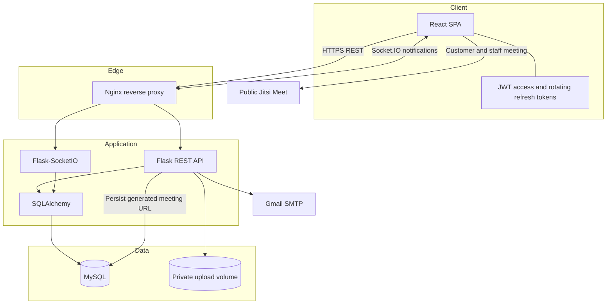
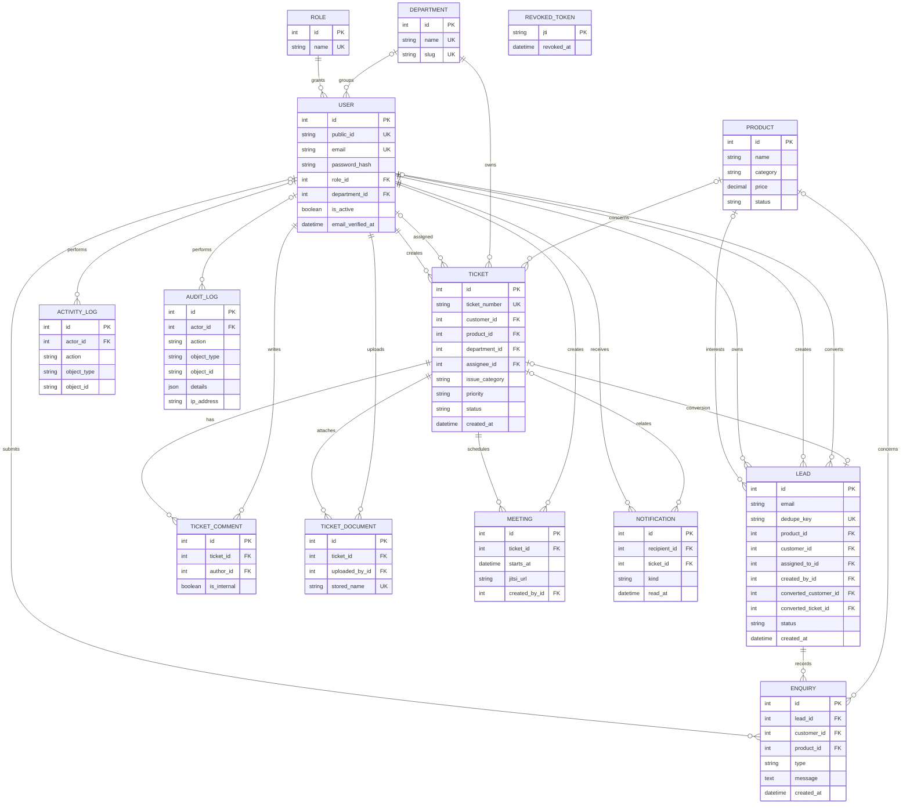

# System design

## Component view

## Entity relationship view

## Authorization and routing

- Public registration always creates a Customer. The first Main Admin is created only by the `flask seed` command with explicit admin environment variables. The web UI cannot grant the Main Admin role.
- Customers can see only their own tickets and non-internal comments. Staff can see tickets in their own department or explicitly assigned to them. Main Admin can read ticket overviews and details, but ticket conversations, attachments, and updates remain restricted to customers and assigned staff.
- A ticket's issue category selects the default department. Critical priority on creation routes the ticket to the Main Admin queue and sends a status-only in-app and Socket.IO alert. Product Maintenance can update and resolve defect tickets directly; changing a ticket's priority does not reroute it.
- SQLAlchemy query construction is used for database access; request text is never interpolated into SQL.
- Sales enquiries deduplicate active leads using a unique hash of the normalized email; each submission remains a separate enquiry-history row. Conversion transactionally links that history to the customer. Signed-in support requests create routed tickets directly and do not enter the lead pipeline.
- Uploaded files use generated storage names and are only downloadable after the caller passes the ticket visibility check.

## Operational boundaries

- REST and Socket.IO run in a single Gunicorn worker in the provided configuration so in-process Socket.IO rooms remain consistent. For multiple API instances, configure a shared Socket.IO message queue and shared durable upload storage before scaling.
- Alembic is the production schema authority. `init-db`/`db.create_all()` is only a local development convenience; production uses `flask db upgrade`.
- SMTP and public Jitsi depend on third-party account limits and availability. The API includes an `email_sent` result for notification-triggering operations; local debug returns links for testing.
- SQLite is for a single-user developer instance. Production uses MySQL with backups and TLS-protected network access.
